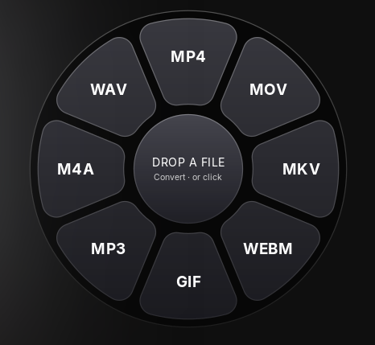
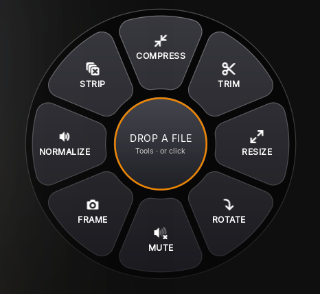
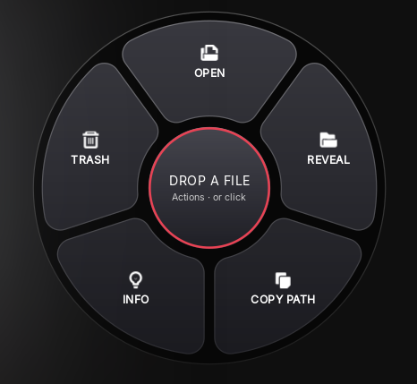

# Narenj

A drag-and-drop ffmpeg wheel for GNOME, Windows and macOS, inspired by [Tangerine](https://tangerineformac.com/) and FanDrop on macOS.

Drag a file onto the wheel and drop it on a wedge: Narenj converts, compresses, trims or otherwise
processes it with ffmpeg and saves the result next to the original. Everything runs locally.

<p align="center">
  
  
  
</p>
<p align="center"><sub>The Convert, Tools and Actions wheels (Shift, Ctrl, Alt) in the dark theme</sub></p>

## Wheels

| Wheel | Video | Audio | Image |
|---|---|---|---|
| Convert | MP4, MOV, MKV, WebM, GIF, animated WebP, MP3, SRT subtitles | MP3, M4A, WAV, FLAC, OGG, Opus | PNG, JPG, WebP, BMP, TIFF, ICO |
| Tools | Compress, Trim, Resize, Rotate, Mute, Frame, Normalize, Strip metadata | Compress, Trim, Normalize, Mono, Strip metadata | Compress, Resize, Rotate, Grayscale, Strip metadata |
| Actions | Open, Reveal in Files, Copy path, Info, Trash, Join | same | Open, Reveal, Copy path, Info, Trash |

A wheel never shows more than 8 wedges, and Convert hides the file's own format. SVG files count as
images (their tools write PNG). **Join** puts several videos or songs end to end, in name order;
videos of different sizes are fitted to the first one's frame. **SRT** pulls out a video's first
subtitle track.

## Using it

- **Ctrl+Alt+N** opens the wheel; pressing it again closes it.
- The tabs above the wheel switch between Convert, Tools and Actions (hold a dragged file over one
  to switch); the × next to them closes Narenj.
- Drop a file on a wedge to run it, or on the centre to load the file and then click a wedge.
- Click the centre to pick files; drag the centre to move the wheel.
- Right-click for the menu: choose files, settings, glass level (clear / regular / tinted), cancel jobs, quit.
- Arrow keys pick a wedge, Enter applies it, Esc clears the selection.

## Settings

Right-click the wheel and choose **Settings…** (or press Ctrl+,):

- **Opens on**: the wheel shown when Narenj starts (Convert, Tools or Actions).
- **Glass**: how much of the desktop shows through.
- **Open and close the wheel**: click the shortcut and press a new key combination; Esc cancels,
  Backspace turns the shortcut off.

The wheel is a borderless, translucent window. A small GNOME Shell extension keeps it above other
windows on every workspace and reports the modifier keys held during a drag, since Wayland gives
apps no way to do either.

## Install

### From the apt repository (Ubuntu 22.04+ / Debian)

```sh
sudo install -d -m 0755 /etc/apt/keyrings
curl -fsSL https://hastashakiba.github.io/narenj/narenj-archive-keyring.gpg | sudo tee /etc/apt/keyrings/narenj.gpg >/dev/null
echo "deb [signed-by=/etc/apt/keyrings/narenj.gpg] https://hastashakiba.github.io/narenj stable main" | sudo tee /etc/apt/sources.list.d/narenj.list
sudo apt update
sudo apt install narenj
narenj --setup                      # once per user: shortcut + extension
```

Log out and back in once so GNOME Shell loads the extension. Updates then arrive with `apt upgrade`.

### Windows 10 / 11

Download `narenj-<version>-setup.exe` from the [latest release](https://github.com/HAstaShakiba/narenj/releases/latest)
and run it; it installs for your user without admin rights and brings its own Python, GTK and ffmpeg.
**Ctrl+Alt+N** opens and closes the wheel (change it in Start menu › Narenj › Properties ›
Shortcut key). On Windows the wheel stays above other windows and reads Shift, Ctrl and Alt by
itself, so nothing else needs setting up.

### macOS app (Apple Silicon)

Download `narenj-<version>-macos.dmg` from the [latest release](https://github.com/HAstaShakiba/narenj/releases/latest),
open it and drag Narenj to Applications. The app is not signed with an Apple Developer ID, so the
first time macOS says it cannot verify it: open **System Settings › Privacy & Security** and click
**Open Anyway** (or run `xattr -dr com.apple.quarantine /Applications/Narenj.app`). Intel Macs use
Homebrew below.

### macOS (Homebrew)

```sh
brew tap hastashakiba/narenj https://github.com/HAstaShakiba/narenj
brew install narenj
narenj
```

Homebrew brings GTK, Python and ffmpeg. While Narenj runs, **Control+Option+N** shows and hides the
wheel, which floats above other windows on every Space; Shift, Control (or Command) and Option
switch wheels, also while dragging.

### Building the package yourself

```sh
./packaging/build-deb.sh            # writes dist/narenj_1.0.0_all.deb
sudo apt install ./dist/narenj_1.0.0_all.deb
narenj --setup                      # once per user: shortcut + extension
```

### From this checkout (current user only)

```sh
./install.sh
```

## Requirements

GNOME 42 or newer on Wayland, Python 3 with PyGObject, GTK 4.6+, libadwaita 1.1+, librsvg, ffmpeg.
On Ubuntu 22.04 the package pulls in everything it needs, including `fonts-inter`.

The UI uses Apple's San Francisco font when it is installed and otherwise
[Inter](https://rsms.me/inter/), its closest open counterpart. `fonts/InterVariable.ttf` is
Inter 4.1, distributed under the SIL Open Font License (see `fonts/LICENSE-Inter-OFL.txt`).
On Windows it uses Segoe UI. The Windows installer and the macOS app bundle FFmpeg 8.1.3, built from the
[ffmpeg.org](https://ffmpeg.org/download.html) sources by `packaging/build-ffmpeg.sh` with
x264, libvpx, Opus, LAME, Vorbis, libwebp and dav1d; that build is GPL licensed.

## Development

```sh
python3 -m unittest discover -s tests     # wheel contents + every ffmpeg wedge on generated media
```

GitHub Actions runs the same tests on every push and pull request.

## Releasing

1. Build and publish the apt repository: `./packaging/build-deb.sh 1.0.1 && ./packaging/publish-apt.sh`.
   It signs the repository with the "Narenj apt repository" GnuPG key and pushes it to the
   `gh-pages` branch (`--dry-run` builds it in `dist/apt-site` instead).
2. Tag the release: `git tag -a v1.0.1 -m "Narenj 1.0.1" && git push origin v1.0.1`.
   GitHub Actions tests it, builds the `.deb` and publishes the GitHub release.

Keep a backup of the signing key (`gpg --export-secret-keys "Narenj apt repository"`): without
it, updates can no longer be signed for people who already trust the repository.

## License

Narenj is released under the MIT License (see `LICENSE`). The bundled Inter font keeps its own
SIL Open Font License.

## Layout

| Path | Contents |
|---|---|
| `narenj.py` | The application |
| `gnome-extension/` | Shell helper for GNOME 42-44 |
| `gnome-extension-45/` | The same helper for GNOME 45+ (ES modules) |
| `packaging/` | `.deb` build script, launcher and desktop entry |
| `packaging/windows/` | Windows build (MSYS2) and Inno Setup installer |
| `Formula/` | Homebrew formula for macOS |
| `packaging/macos/` | macOS app (PyInstaller) and DMG build |
| `packaging/build-ffmpeg.sh` | The slim ffmpeg bundled on Windows and macOS (settings in `packaging/*/ffmpeg.sh`) |
| `install.sh` | Per-user install from the checkout |
| `tests/` | Wheel contents and every ffmpeg wedge on generated media |
| `icons/` | The wedges' symbolic icons, from GNOME's Adwaita theme (LGPL v3 / CC BY-SA 3.0) |
| `Screenshot/` | The images above |
